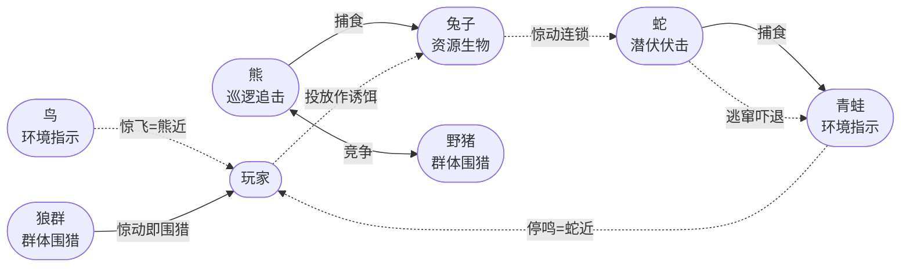

# 森林生存小游戏｜生态耦合设计 v0.2

> 目标：把「多只动物」从美术资产变成玩法系统。
> 一句话定位：耦合不是给动物加戏，是给玩家造工具、给行为造后果。

变更记录

- v0.2：移除「生态反噬」。该机制需要跨关卡累积才能被感知，与 2 分钟单局不匹配。第 22 关改为「群体围猎」。
- v0.1：首版，含十条耦合、三条连锁反应。

---

## 一、设计原则：三条硬指标

每条耦合必须同时满足：

1. 可观察 —— 玩家能感知到它发生了（声音、动画、图标）
2. 可利用 —— 玩家能主动用它达成目的
3. 有代价 —— 利用它要付出资源、时间或后续风险

只做到第 1 条，那是动画；做到 1 加 2，那是玩法；三条齐全，才叫生态。

补充一条单局约束：**所有效果必须在 2 分钟内闭合。** 触发、反馈、代价都要发生在同一局里，超出单局的因果不要放进关卡设计。

---

## 二、行为原型（决定实现成本）

不要按物种写 AI，按行为原型写。同一种原型在不同场景换皮即可复用。

| 原型 | 行为特征 | 玩家应对 |
|---|---|---|
| 潜伏伏击 | 隐藏、静止、触发式攻击 | 观察信号，绕行或驱赶 |
| 巡逻追击 | 固定路线，发现后追击 | 利用地形或其它动物摆脱 |
| 群体围猎 | 个体警觉联动整群 | 避免惊动，分化引诱 |
| 环境指示 | 行为随环境变化 | 把它的行为当预警读 |
| 资源生物 | 可猎取、会逃跑 | 捕猎，或当作诱饵 |

森林这只手牌里的 4 种动物，正好覆盖其中 4 类原型。后面的场景全部靠复用。

---

## 三、生态关系图

实线代表动物之间的直接关系，虚线代表玩家可读的预警或可利用的交互。

---

## 四、耦合明细

| ID | 耦合 | 类型 | 触发条件 | 玩家可利用 | 代价 |
|---|---|---|---|---|---|
| C1 | 熊捕兔 | 捕食 | 熊进入兔子的感知范围 | 把兔子引向熊，改变熊的路线 | 兔群减少后，熊转向玩家 |
| C2 | 蛇捕蛙 | 捕食 | 蛇靠近水边 | 借蛇清掉蛙，打开水域通道 | 失去蛙鸣预警 |
| C3 | 熊斗野猪 | 竞争 | 两者领地在同一区域重叠 | 引两强相斗，趁乱采集 | 败者进入狂暴状态 |
| C4 | 蛙停鸣 | 预警 | 蛇进入水边 | 提前避险，预判伏击点 | 蛙被吓跑后信号消失 |
| C5 | 鸟惊飞 | 预警 | 熊接近 | 远距离预警 | 蛇也可能惊鸟，产生假警报 |
| C6 | 兔子作诱饵 | 利用 | 玩家捕捉或驱赶兔子 | 引开追击中的熊 | 消耗一只兔子 |
| C7 | 群体围猎 | 群体 | 一只成员发现玩家 | 逐个引诱、分化处理 | 惊动一只等于惊动全部 |
| C8 | 惊兔引蛇 | 连锁 | 兔子窜入草丛 | 反向利用，把蛇引到别处 | 失去预警，区域变危险 |
| C9 | 断链自救 | 连锁 | 被熊追击时跳入水中 | 让蛇咬熊，借力脱身 | 蛇被激怒，水域短期危险 |

---

## 五、三条连锁反应

连锁是玩家真正会记住、会主动讨论的部分。每条链都有短期收益和长期代价，且都在单局内闭合。

### 连锁 A｜惊兔引蛇

1. 玩家惊动兔子
2. 兔子窜入草丛
3. 惊动藏在草里的蛇
4. 蛇冲向水边，吓跑青蛙
5. 蛙鸣停止，玩家失去预警
6. 熊接近时没有任何提示

一次操作失误引发整条链。玩家学到的是：兔子不只是猎物，它是这条链的扳机。

### 连锁 B｜引熊斗猪

1. 在野猪领地附近投放兔子
2. 熊追兔进入野猪领地
3. 熊与野猪互斗，双双受伤
4. 玩家趁乱采集
5. 受伤的熊进入狂暴，本局内更难处理

短期收益换取即时代价，这是决策价值最高的一条。

### 连锁 C｜断链自救

1. 被熊追击
2. 跳入水潭
3. 惊醒水中的蛇
4. 蛇咬熊，熊转攻蛇
5. 玩家趁机脱身
6. 蛇被激怒，本局内水域不可再用

把「害」变成「救」。玩家自己发现这一手的时候，成就感最强。

---

## 六、可观察性：信号设计

每条耦合必须给玩家一个可读信号，否则等于不存在。

| 耦合 | 视觉 | 听觉 |
|---|---|---|
| 蛙停鸣 | 水面涟漪消失 | 蛙叫突然停止（用安静表现） |
| 鸟惊飞 | 树冠鸟群飞起 | 翅膀拍打声 |
| 熊接近 | 地面轻微震动、灌木晃动 | 低吼、脚步声 |
| 蛇伏击 | 草丛不自然抖动 | 嘶声 |
| 群体警觉 | 远处出现多双眼睛 | 短促吠叫 |

补充：屏幕边缘放一个小的生态提示图标，第一次触发某条耦合时高亮，帮助玩家建立认知。

---

## 七、生态图鉴

每发现一条耦合解锁一条图鉴条目，包含四件事：参与方、关系、如何利用、如何规避。

一物三用：教学、收集要素、重玩动机。图鉴皮肤可以单独作为付费点。

---

## 八、关卡映射

对应 30 关主线里的第四章（19 到 24 关）。

| 关卡 | 教学重点 | 对应耦合 |
|---|---|---|
| 19 | 捕食：用兔子引开熊 | C1、C6 |
| 20 | 预警：靠蛙鸣避险 | C2、C4、C5 |
| 21 | 竞争：让两强互相牵制 | C3 |
| 22 | 群体：惊动一只等于惊动全部 | C7 |
| 23 | 连锁：暴雨下的多米诺 | C8、C9 |
| 24 | 综合：迁徙全程利用耦合 | 全部 |

---

## 九、跨场景复用

同一套行为系统，只换外观、数值和信号音效。

| 原型 | 森林 | 沼泽 | 沙漠 | 雪原 | 洞穴 | 海岸 |
|---|---|---|---|---|---|---|
| 潜伏伏击 | 蛇 | 鳄鱼 | 蝎子 | 冰下生物 | 蜘蛛 | 海蛇 |
| 巡逻追击 | 熊 | 野猪 | 鬣狗 | 雪豹 | 地下熊 | 鲨鱼 |
| 群体围猎 | — | 蚊群 | 鬣狗群 | 狼群 | 蝙蝠群 | 蟹群 |
| 环境指示 | 青蛙 | 萤火虫 | 沙鼠 | 鸟 | 发光菌 | 海鸟 |
| 资源生物 | 兔子 | 鱼 | 蜥蜴 | 雪兔 | 盲鱼 | 海龟 |

---

## 十、工程约束

1. 目标系统必须支持任意实体。动物 AI 的追击和攻击目标不能写死为玩家，要能指向其他动物。这一条现在做几乎零成本，之后补的代价很大。
2. 耦合用数据表配置。触发条件、参与方、效果都放进配置，不硬编码，方便关卡调参。
3. 事件驱动。动物之间用事件通知（发现、受击、逃逸），不要每帧轮询全场。
4. 信号要能单独开关。调试时能关掉某条耦合的提示，方便定位问题。

---

## 十一、下一步

- [ ] 确认五类行为原型是否够用
- [ ] 定每条耦合的具体数值（触发距离、持续时间、代价）
- [ ] 画出森林场景的完整关系图
- [ ] 把 C1 到 C7 落到第 19 到 24 关的关卡脚本
