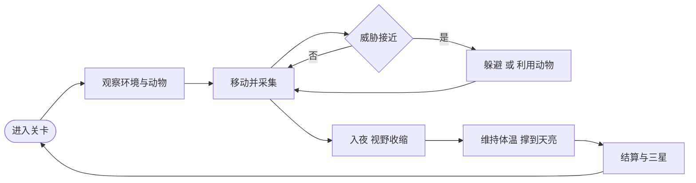

# 森林求生｜游戏设计文档 v1.1

> 纯设计文档。只写游戏本身怎么做，不含市场分析与商业判断。
> 商业与市场部分见 `hyper-casual-forest-design.md`，气质改造见 `cozy-lite-survival-design.md`，实施跟踪见 `implementation-roadmap.md`。

## 变更记录

- **v1.1**：写入 cozy-lite survival 定位；补充黄昏过渡、失败/结算气质、关卡「夜」称谓、HUD 语义与验收 C 项。数值与核心循环不变。
- **v1.0**：首版定稿。

## 0. 文档约定

| 约定 | 说明 |
|---|---|
| 基准分辨率 | 750 × 1334，所有像素数值以此为基准，运行时等比缩放 |
| 坐标系 | 左上角为原点，向右向下为正 |
| 单位 | 距离用像素，时间用秒，速度用像素每秒 |
| 命名 | 动物、机制用英文标识符；关卡对外称「第 N 夜」；界面文案走 i18n |

### 0.1 产品定位（v1.1）

**品类切面：cozy-lite survival（舒服的轻度生存关卡游戏）。**

- 有真实生存压力（体温、熊、夜），但短局可控、观感温暖。
- 不是硬核生存，也不是纯超休闲点点点。
- 改造细则与平台包装见 `cozy-lite-survival-design.md`。
- **不新增**背包、技能、建造、养成；深度仍只加在「移动」上。

---

# 一、核心体验

## 1.1 一句话

**单指拖动，在森林里活到天亮。**

海外工作名与定位句见 cozy-lite 文档（Nightfall Forest / one thumb, one dawn）。

## 1.2 核心动作

**单指按住拖动，角色朝手指方向移动，松手停下。**

整个游戏只有这一个操作。没有按钮，没有技能栏，没有背包，没有跳跃键。

设计约束：

- 任何时刻玩家都能用一根手指完成全部操作
- 角色移动与手指位置直接对应，不做延迟跟随
- 屏幕任意位置可按下，不要求手指落在角色身上
- 不存在需要双指、长按超过 1.5 秒、或多点触控的操作

## 1.3 唯一目标

**活到天亮。**

关卡目标全部收敛为这一句话。资源不是并列目标，而是活下去的手段。

界面主信息是：**离天亮（或黄昏）的倒计时**与**温暖条（体温）**。关卡名、目标进度、星星为次要常驻信息，呈现须安静，避免数据板感。

## 1.4 核心循环

单局时长 60 到 120 秒。单个循环约 3 到 5 秒，即一次移动决策的时间。

节拍由昼夜切换划分：白天是学习与积累，夜晚是压力与检验。

**节奏气质（v1.1）：** 白天从容；入夜前有 5–8 秒黄昏过渡（渐暗、色温偏冷、音频交叉淡入），禁止硬切全黑；夜晚短而尖；火堆旁必须读得出安全感。多数关允许安全通关也舒服，三星才鼓励冒险。

## 1.5 三处深度

三处深度全部作用在「移动」这一个动作上。玩家三秒能感知，三十小时才能玩透。

| 深度 | 机制 | 玩家学到什么 |
|---|---|---|
| 模式识别 | 动物行为有固定规律，可预测 | 走位变成一道可解的小谜题 |
| 风险定价 | 好资源永远在危险附近 | 每次移动都是风险收益判断 |
| 时间压力 | 昼夜改变同一动作的难度 | 同一套走位白天成立、夜晚危险 |

### 1.5.1 模式识别

动物行为必须简单到能被看穿，不做随机。玩家玩三局就能背下规律，之后开始主动利用。

### 1.5.2 风险定价

安全区只刷普通资源，危险区刷高价值资源。不用说明，玩家看一眼地图就懂。

### 1.5.3 时间压力

白天视野全开、动物温和。夜晚视野缩小、动物活跃。同一套走位在夜晚就是另一种难度。

## 1.6 惊喜层：隐藏耦合

**耦合不做成教学，做成玩家自己撞上的惊喜。**

不解释任何规则。玩家被熊追击时慌乱跑向兔子，熊转身去追兔子，玩家脱身。玩家会愣一下，然后自己去试第二次。

首版只保留一条耦合：**兔子可以引开熊。** 完整耦合清单见 `ecology-coupling-design.md`，第二阶段启用。

---

# 二、世界

## 2.1 场景基调

| 场景 | 主色 | 光照 | 密度 | 章节 |
|---|---|---|---|---|
| 森林 | 苔绿与暖褐 | 斑驳树影 | 中 | 林缘、深处、猎场 |
| 沼泽 | 暗绿与泥褐 | 浑浊漫射 | 中低 | 水岸 |
| 沙漠 | 金黄与赭石 | 强烈直射 | 低 | 沙海 |
| 雪原 | 冷白与青灰 | 均匀散射 | 低 | 深冬 |

## 2.2 地图模板

五个模板负责地形与遮挡，关卡的差异主要由模板加参数组合产生。

| 模板 ID | 名称 | 尺寸 | 遮挡物 | 布局规则 | 教学价值 |
|---|---|---|---|---|---|
| `clearing` | 开阔草地 | 1600 × 1200 | 无 | 散点分布 | 入门，移动与采集 |
| `grove` | 密集树林 | 1400 × 1200 | 28 棵树 | 树簇散布 | 潜行与遮挡 |
| `pond` | 水潭区 | 1500 × 1300 | 10 棵树 | 水域环绕 | 水域与预警 |
| `corridor` | 狭窄通道 | 1800 × 900 | 22 棵树 | 长条通道 | 路线规划 |
| `den` | 领地中心 | 1500 × 1500 | 16 棵树 | 环形包围 | 高风险高收益 |

通用规则：

- 玩家出生点在地图中心偏上，距任何危险物至少 260 像素
- 资源点与动物点不重叠，且不落在遮挡物上
- 地图四周留出 80 像素不可达边界，避免角色贴边
- 遮挡物高度大于角色，绘制时按 y 排序，实现前后遮挡

## 2.3 昼夜

| 参数 | 白天 | 黄昏过渡 | 夜晚 |
|---|---|---|---|
| 时长 | 约 60 秒（按关卡） | 5–8 秒 | 约 30 秒（按关卡） |
| 视野 | 全屏 | 由全屏收到夜视野 | 圆形，半径 320 像素 |
| 视野外亮度 | 无 | 渐变 | 25% |
| 熊移动速度 | 62 | 过渡中仍用昼速 | 88 |
| 蛇触发半径 | 46 | 46 | 46 |
| 资源刷新频率 | 100% | 100% | 50% |

夜晚不是简单变暗，它同时改变三件事：**可见范围、动物速度、资源密度**。玩家对同一个动作的判断必须在两种状态下切换。

黄昏过渡是强制体验，不是可选项：用光线与声音预告入夜，让紧张可控，而不是惊吓式切黑。

## 2.4 天气（第二阶段）

| 天气 | 效果 | 首发章节 |
|---|---|---|
| 暴雨 | 视野再缩 20%，体温下降速率翻倍 | 水岸 |
| 浓雾 | 视野缩至 180 像素，遮挡物半透明 | 深处 |
| 沙暴 | 移动方向受横向偏移干扰 | 沙海 |
| 霜降 | 火堆消耗速率翻倍 | 深冬 |

## 2.5 资源

| 资源 | 图标 | 效果 | 位置 |
|---|---|---|---|
| 浆果 | 红色小果 | 分数 1，食用恢复体温 15 | 全图，偏安全区 |
| 金浆果 | 金色发亮果实 | 分数 3，食用恢复体温 40 | 仅危险区 |
| 木头 | 原木 | 维持火堆，每 10 秒消耗 1 个 | 树旁 |
| 药草 | 绿色叶簇 | 解除中毒 | 草丛深处 |

## 2.6 火堆

夜晚的庇护所，规则必须一眼可懂。

| 规则 | 数值 |
|---|---|
| 保暖半径 | 180 像素 |
| 半径内体温 | 每秒 +6 |
| 半径外体温 | 每秒 -2.5 |
| 木头消耗 | 每 10 秒 1 个 |
| 熄灭后 | 半径内不再回温 |
| 不可移动 | 火堆位置在关卡开始时确定 |

---

# 三、角色与动物

## 3.1 玩家

| 项 | 值 |
|---|---|
| 碰撞半径 | 14 像素 |
| 移动速度 | 180 像素每秒 |
| 转向加速度 | 900 像素每秒平方 |
| 停止减速度 | 1400 像素每秒平方 |
| 体温上限 | 100 |
| 视觉 | 圆形或简单人形，带阴影 |

体温降到 0 即失败。

## 3.2 行为原型

所有动物按行为原型实现，同一原型在不同场景只换外观与数值。

| 原型 | 行为特征 | 玩家应对 | 森林 | 沼泽 | 沙漠 | 雪原 |
|---|---|---|---|---|---|---|
| 潜伏伏击 | 隐藏、静止、触发式攻击 | 观察信号，绕行 | 蛇 | 鳄鱼 | 蝎子 | 冰下生物 |
| 巡逻追击 | 固定路线，发现后追击 | 利用地形或别的动物 | 熊 | 野猪 | 鬣狗 | 雪豹 |
| 群体围猎 | 个体警觉联动整群 | 避免惊动，分化 | — | 蚊群 | 鬣狗群 | 狼群 |
| 环境指示 | 行为随环境变化 | 当作预警读 | 青蛙 | 萤火虫 | 沙鼠 | 鸟 |
| 资源生物 | 可猎取、会逃跑 | 捕猎或当诱饵 | 兔子 | 鱼 | 蜥蜴 | 雪兔 |

## 3.3 动物规格

### 熊

| 项 | 值 |
|---|---|
| 状态机 | PATROL → SUSPICIOUS → CHASE → SEARCH → PATROL |
| 巡逻速度 | 62 像素每秒 |
| 追击速度 | 88 像素每秒 |
| 感知距离 | 260 像素 |
| 视锥 | 90 度 |
| 警觉停顿 | 0.8 秒，头顶出现感叹号 |
| 丢失目标 | 2 秒后转 SEARCH |
| 搜索时长 | 3 秒，回到最后已知位置附近 |
| 接触判定 | 距离小于 34 像素，玩家被抓 |

### 蛇

| 项 | 值 |
|---|---|
| 行为 | 完全静止，伏在草丛里 |
| 触发半径 | 46 像素 |
| 咬击延迟 | 0.4 秒，有嘶声预警 |
| 中毒效果 | 体温 -30，3 秒后自动解除 |
| 解除方式 | 药草，或等 3 秒 |

### 兔子

| 项 | 值 |
|---|---|
| 逃跑触发 | 玩家进入 300 像素 |
| 逃跑速度 | 120 像素每秒 |
| 逃跑方向 | 背离玩家，带少量随机偏移 |
| 捕获判定 | 距离小于 26 像素 |
| 捕获收益 | 分数 2，可作诱饵 |
| 诱饵行为 | 熊追击时若兔子在 220 像素内，熊改为追兔子，持续 4 秒 |

## 3.4 生态耦合

首版启用一条，第二阶段启用完整清单。

| 耦合 | 状态 |
|---|---|
| 兔子引开熊 | 首发启用，不教学 |
| 蛇捕蛙、蛙停鸣预警、鸟惊飞预警 | 第二阶段 |
| 熊与野猪竞争、群体围猎、连锁反应 | 第二阶段 |

---

# 四、关卡

## 4.1 结构

| 项 | 值 |
|---|---|
| 总关数 | 50（对外称 50 夜） |
| 章节数 | 5，每章 10 夜 |
| 单关时长 | 60 到 120 秒 |
| 地图模板 | 5 种 |
| 目标类型 | collect / survive / score / gold |
| 星级条件 | 每关 3 条，从固定集合取 |
| 展示名 | `第 {n} 夜 · {短名}`，禁止只显示光秃关卡号 |

## 4.2 章节

| 章 | 名称 | 模板 | 主题 | 夜次 |
|---|---|---|---|---|
| 一 | 林缘 | clearing, grove | 基础，森林边缘 | 1 到 10 |
| 二 | 深处 | grove, corridor | 树更密，出现蛇 | 11 到 20 |
| 三 | 水岸 | pond | 水潭与青蛙 | 21 到 30 |
| 四 | 猎场 | den, grove | 熊的领地 | 31 到 40 |
| 五 | 深冬 | corridor, den | 综合与约束 | 41 到 50 |

每章进入时给 ≤2.5 秒可跳过的静帧过场（色温/地标剪影即可）。自第 5 夜起，每夜至少配置一个可发现的小秘密（捷径、非常规兔子/金果、或夜间信号），不做文字教学。

## 4.3 难度曲线

| 区段 | 重点 | 手段 |
|---|---|---|
| 1 到 12 | 每关一个新机制 | 单一变量，逐个引入 |
| 13 到 30 | 机制组合 | 两两叠加，熊加蛇、资源加熊、夜间资源减少 |
| 31 到 50 | 综合与约束 | 加天气、缩视野、限时收紧，靠约束不靠数值 |

**不通过提升敌人血量或移速来变难。** 难度只来自规则组合和信息量。

## 4.4 目标与星级

### 目标类型

| ID | 说明 | 示例 |
|---|---|---|
| `collect` | 采集 N 个资源 | 采集 3 个浆果 |
| `survive` | 撑到天亮 | 活到天亮 |
| `score` | 达到分数线 | 达到 6 分 |
| `gold` | 拿到 N 个金浆果 | 拿到 1 个金浆果 |

### 星级条件

| ID | 说明 |
|---|---|
| `complete` | 完成主目标，必选 |
| `time` | 在 X 秒内完成 |
| `undetected` | 全程未被熊发现 |
| `no_damage` | 全程未受伤 |
| `gold` | 拿到 N 个金浆果 |
| `decoy_used` | 成功用兔子引开熊 N 次 |
| `fire_alive` | 火堆全程未熄灭 |

## 4.5 前四关详细

### 第一关：学会移动

| 项 | 内容 |
|---|---|
| 时长 | 60 秒，纯白天 |
| 模板 | clearing |
| 动物 | 熊 1 只，固定巡逻，不追击 |
| 资源 | 浆果 5 个 |
| 目标 | collect 3 |
| 引导 | 一个箭头指向最近的浆果，无文字 |
| 三星 | 完成 / 30 秒内 / 全程未被熊发现 |

### 第二关：学会夜晚

| 项 | 内容 |
|---|---|
| 时长 | 90 秒，白天 60 加夜晚 30 |
| 模板 | clearing |
| 动物 | 熊 1 只，白天巡逻，夜晚追击 |
| 资源 | 浆果 6 个，木头 3 个 |
| 场景 | 火堆 1 个 |
| 目标 | survive |
| 变化 | 夜晚视野缩小到 320 像素 |
| 三星 | 存活 / 火堆不灭 / 夜晚零受伤 |

### 第三关：学会风险定价

| 项 | 内容 |
|---|---|
| 时长 | 90 秒 |
| 模板 | grove |
| 动物 | 熊 1 只 |
| 资源 | 安全区浆果 3 个，熊巡逻路线上金浆果 1 个 |
| 目标 | score 6 |
| 三星 | 达标 / 拿到金浆果 / 零受伤 |

### 第四关：学会发现

| 项 | 内容 |
|---|---|
| 时长 | 90 秒 |
| 模板 | grove |
| 动物 | 熊 1 只，兔子 2 只 |
| 资源 | 浆果 6 个 |
| 目标 | survive |
| 关键 | 不解释兔子，靠近兔子时熊转向追兔子 |
| 三星 | 存活 / 成功引开一次 / 全程没被熊碰到 |

---

# 五、界面与交互

## 5.1 HUD

主信息少而安静，位置固定。语义按 cozy-lite 呈现（系统内部仍可用体温等字段名）。

| 元素 | 位置 | 说明 |
|---|---|---|
| 温暖条（体温） | 屏幕顶部居中 | 横向填充条，满值 100 |
| 倒计时 | 温暖条下方 | 昼：离黄昏；夜：离天亮 |
| 夜名称 | 顶部一侧 | `第 N 夜 · 短名` 与本夜目标 |
| 星星 | 顶部一侧 | 三星实时状态，不闪促销色 |
| 分数 | 屏幕右上角 | 小号、次要 |
| 采集提示 | 屏幕左下角 | 当前目标进度，例如 2/3，只用数字与图标 |

**禁止**在 HUD 上出现教程文字、按键提示、箭头以外的引导图形、活动入口、闪烁礼包。

## 5.2 输入

| 规则 | 说明 |
|---|---|
| 触发 | 屏幕任意位置按下 |
| 控制 | 角色朝手指位置移动，最大偏移 120 像素 |
| 释放 | 角色减速停下 |
| 采集 | 走到资源上自动采集，不需要额外点击，采集耗时 0.8 秒 |
| 中断 | 采集被惊动时取消，资源不消失 |

**采集不额外点击**是关键。玩家只有「走」这一个动作，采集是走的副产品。

## 5.3 摄像机

| 项 | 值 |
|---|---|
| 跟随 | 死区 40 像素，插值系数 0.12 |
| 缩放 | 固定 1.0，夜晚不缩放 |
| 视野遮罩 | 夜晚用圆形遮罩，半径 320 像素，边缘 40 像素羽化 |
| 边界 | 限制在地图范围内，不露出地图外 |

## 5.4 结算

| 元素 | 说明 |
|---|---|
| 结果 | 成功：「天亮了」；失败：「今晚没撑住」（判定逻辑不变） |
| 摘要 | 本夜图标化摘要（火堆、诱饵、受伤等） |
| 三星 | 三个星星图标，未达成显示为空心，不闪红惩罚感 |
| 图鉴 | 若首次触发机制，给静默解锁提示 |
| 分数 | 结算分数，次要 |
| 按钮 | 再试一夜、下一夜、分享（国内） |

失败演出：轻暗角、抖动减半、柔和下行音；禁止以强红闪+惊吓音为主反馈。

## 5.5 教学原则

**零文字。** 教学全部靠关卡设计、箭头、图标和声音传达。

第 1 夜用一个箭头指向浆果。第 2 夜经黄昏过渡后视野收缩，靠近火堆时温暖条回升，玩家自然理解火堆。第 4 夜不解释兔子，机制由玩家试错发现。

---

# 六、数值总表

## 6.1 玩家

| 参数 | 值 |
|---|---|
| 碰撞半径 | 14 |
| 移动速度 | 180 |
| 转向加速度 | 900 |
| 停止减速度 | 1400 |
| 体温上限 | 100 |
| 体温归零 | 失败 |

## 6.2 动物

| 参数 | 熊 | 蛇 | 兔 |
|---|---|---|---|
| 碰撞半径 | 20 | 16 | 12 |
| 移动速度 | 62 / 88 夜 | 0 | 120 |
| 感知距离 | 260 | 70 | 300 |
| 触发半径 | 34 接触 | 46 | 26 捕获 |
| 视锥 | 90 度 | 360 | 360 |

## 6.3 资源与状态

| 参数 | 值 |
|---|---|
| 浆果分数 | 1 |
| 金浆果分数 | 3 |
| 浆果回温 | 15 |
| 金浆果回温 | 40 |
| 木头消耗 | 火堆每 10 秒 1 个 |
| 白天体温 | 不变 |
| 夜晚火堆内 | 每秒 +6 |
| 夜晚火堆外 | 每秒 -2.5 |

## 6.4 采集

| 参数 | 值 |
|---|---|
| 采集耗时 | 0.8 秒 |
| 拾取半径 | 28 像素 |
| 资源刷新间隔 | 白天 6 秒，夜晚 12 秒 |

---

# 七、美术方向

## 7.1 风格定位

**扁平几何加轻微体积感的低多边形风。**

选择理由有三层。一是 AI 生成的一致性在这个风格下最好，逐帧写实和等距视角都是崩溃重灾区。二是这种风格体积小，适配小游戏包体限制。三是程序化动画在这种风格下最自然，缩放旋转加位移就能做出可读的动效。

不做的：写实光照、复杂纹理、精细毛发、真实投影。

## 7.2 2.5D 实现方式

不引入等距引擎。用普通 2D 精灵加两点伪装。

| 手段 | 说明 |
|---|---|
| 垂直压缩 | 精灵 Y 轴缩放到 0.85，制造俯视错觉 |
| 接地阴影 | 每个角色和树下方画一个椭圆软阴影 |
| 高度排序 | 按 y 坐标排序绘制，前面的遮挡后面的 |
| 树冠重叠 | 树画成两层，树冠层可遮住角色 |

## 7.3 资产清单

| 类别 | 数量 | 规格 |
|---|---|---|
| 角色 | 玩家 1，动物 3 到 6 | 128 × 128 PNG，透明底 |
| 树 | 3 种 | 256 × 320 PNG |
| 草丛 | 2 种 | 96 × 64 PNG |
| 水潭 | 1 种 | 256 × 256 PNG |
| 火堆 | 2 态 | 128 × 128 PNG |
| 资源 | 浆果、金浆果、木头、药草 | 64 × 64 PNG |
| UI | 体温条、星星、图标组 | 矢量或小图 |
| 背景 | 每场景 1 张可平铺 | 512 × 512 PNG |

## 7.4 动画方案

**全部程序化，不做逐帧。**

| 对象 | 动效 |
|---|---|
| 玩家 | 移动时轻微上下浮动，频率与速度挂钩；停止时呼吸缩放 |
| 熊 | 追击时身体前倾并轻微抖动 |
| 蛇 | 触发瞬间弹起并旋转 15 度，然后收回 |
| 兔 | 逃跑时高频跳动并前倾 |
| 采集 | 资源缩放缩小同时向上飘并淡出 |
| 火堆 | 两层火苗交替缩放，配合亮度闪烁 |
| 受击 | 全屏轻微红闪加摄像机抖动 |

## 7.5 AI 辅助生产流程

1. 先出 5 到 8 张风格样图，选一张定死
2. 之后每次生成都带同一张样图作参考
3. 一个对象一次生成，不批量
4. 输出透明底 PNG，统一到 128 或 256 的整数倍
5. 代码内做程序化动效，不用生成序列帧

---

# 八、音频

| 事件 | 声音 | 备注 |
|---|---|---|
| 背景 | 白天鸟鸣林间，夜晚风声虫鸣 | 昼夜切换时交叉淡入 |
| 采集 | 轻脆拾取音 | 音高随连采递增 |
| 熊警觉 | 低吼加一声闷哼 | 配合感叹号 |
| 熊追击 | 急促脚步 | 距离越近越响 |
| 蛇 | 嘶声 | 触发前 0.4 秒 |
| 蛙鸣 | 短促蛙叫 | 夜间隔一段时间响一次 |
| 夜晚降临 | 一次低频下滑音 | 全局提示 |
| 天亮 | 上行三音 | 正反馈 |
| 受击 | 闷响加心跳 | |

---

# 九、平台适配

## 9.1 微信小游戏

| 项 | 要求 |
|---|---|
| 引擎 | 原生 JS 加 Canvas 2D |
| 适配 | 以 750 × 1334 为基准，等比缩放并居中letterbox |
| 音频 | 用 wx.createInnerAudioContext |
| 存储 | wx.setStorageSync 存进度与设置 |
| 支付 | 无版号，不做内购 |
| 广告 | 激励视频加插屏，复活每关限一次 |

## 9.2 itch.io 与 Steam

| 项 | 要求 |
|---|---|
| 打包 | 同一套代码打成单页应用 |
| 支付 | itch.io 与 Steam 买断，或 Steam DLC |
| 存档 | localStorage |
| 音频 | Web Audio API |
| 尺寸 | 窗口自适应，宽高比不同时用 expand 策略，画面居中 |

## 9.3 YouTube Playables

| 项 | 要求 |
|---|---|
| 技术 | 标准 web API，Canvas 可用，与现有技术栈一致 |
| 形态 | 必须是单页应用 |
| 代码 | 不得混淆，压缩可以 |
| 禁用 | WebAssembly、eval、Web Worker |
| SDK | 启动时调用 firstFrameReady() 与 gameReady() |
| 变现 | 只能用 YouTube 提供的广告能力，官方分成比例未公开且处于试点阶段 |
| 准入 | 开发者接入处于早期，需要提交兴趣表单，审核周期长 |
| 审核 | 会评估 API 合规、隐私政策、信任与安全，以及创作者在 YouTube 上的历史表现 |

Playables 定位为**免费验证渠道与引流渠道**，不承担主要收入。技术上用一层适配隔离，不影响微信版逻辑。

---

# 十、设置与存档

## 10.1 设置项

| 项 | 默认 | 说明 |
|---|---|---|
| 音效音量 | 100% | 独立可调 |
| 音乐音量 | 100% | 独立可调 |
| 语言 | 跟随系统 | 中文 / English |
| 震动 | 开 | 受击时反馈 |
| 画质 | 高 | 低画质关闭阴影 |

## 10.2 存档内容

| 项 | 说明 |
|---|---|
| 关卡进度 | 每关最高星级与最高分 |
| 每日挑战 | 当日成绩与当日种子 |
| 设置 | 音量、语言、画质 |
| 统计 | 累计游玩次数、累计时长 |

存档用版本号字段，便于后续结构变化时迁移。

---

# 十一、验收标准

试玩验收清单，每条都要实际观察并记录在什么分辨率、什么设备下。

| 编号 | 验收项 | 通过标准 |
|---|---|---|
| A1 | 上手 | 新玩家不看任何文字，10 秒内开始移动并采集 |
| A2 | 门槛 | 第一关通过率高于 90% |
| A3 | 深度 | 玩家在第三关后开始主动躲避熊的路线 |
| A4 | 隐藏耦合 | 至少一半测试者在第四关自发使用过兔子引熊 |
| A5 | 手感 | 角色跟手，无明显延迟或惯性拖沓 |
| A6 | 碰撞 | 接触判定宽容，不出现「明明碰到了却没死」 |
| A7 | 分辨率 | 在 4:3、16:9、19.5:9、20:9 下 UI 不越界不重叠 |
| A8 | 安全区 | 刘海屏与手势条屏下 HUD 不被遮挡 |
| A9 | 昼夜 | 夜晚视野外的信息不泄露，亮度可读 |
| A10 | 性能 | 中端手机上稳定 60 帧，帧率不掉到 45 以下 |
| A11 | 无文字 | 前十夜不含任何教学文本 |
| A12 | 单局时长 | 前四夜均在 60 到 120 秒内结束 |
| C1 | 失败不凶 | 测试者不以「吓人/恶心」为主描述失败 |
| C2 | 重试意愿 | 失败后 10 秒内主动重试高于 70% |
| C3 | 夜名称 | 玩家能说出「第几夜」而非只记得关卡号 |
| C4 | 黄昏可读 | 不看教程也能感到快入夜 |
| C5 | 火堆安心 | 有火堆的关，入夜后主动靠近火堆高于 60% |
| C6 | 画面气质 | 去掉 UI 后仍能辨认为温暖林夜，而非通用超休 |

---

# 十二、术语表

| 术语 | 含义 |
|---|---|
| 昼夜 | 一个完整的白天加黄昏过渡加夜晚周期 |
| 夜 | 一关的对外称谓；第 N 夜 = 关卡 N |
| 章节 | 10 夜的分组，有独立主题与视觉 |
| 地图模板 | 决定地形与遮挡的基础布局，5 种 |
| 资源 | 浆果、金浆果、木头、药草 |
| 温暖 / 体温 | 唯一的失败条；界面称温暖，内部可称体温 |
| 火堆 | 夜晚的固定庇护所，需要木头维持，情感上的「家」 |
| 行为原型 | 动物行为的分类，同原型只换外观与数值 |
| 耦合 | 动物之间的互动关系，可被玩家利用 |
| 诱饵 | 把兔子放到熊附近使其改追兔子 |
| 三星 | 每夜三个达成型条件，对应三个星星 |
| cozy-lite | 短局、可控压力、温暖气质的轻度生存切面 |