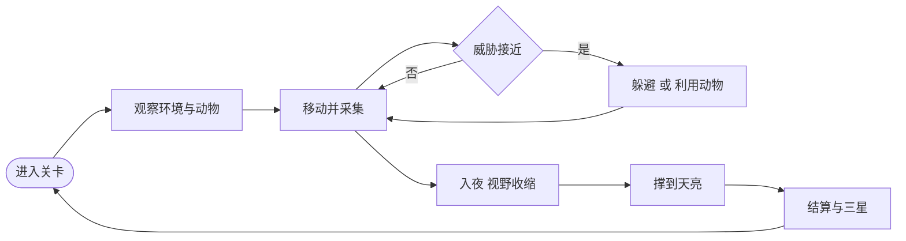

# 森林生存小游戏｜项目设计稿 v2.0

> 定位：超休闲的外壳，可玩性强的内核。
> 判断标准：三秒能懂，三十小时能精。
> 一句话公式：一个动作，三处深度，一个藏起来的惊喜。

## 变更记录

- **v2.2**：海外主切面明确为 **cozy-lite survival**（舒服的轻度生存关卡）；Steam/itch 包装与国内超休话术脱钩；气质改造见 `cozy-lite-survival-design.md`。
- **v2.1**：新增「海外付费变现与曝光路径」，含 Steam 卖量基准、收入算例、题材顺风判断、定价、平台分工、曝光渠道与止损线。
- **v2.0**：项目级重构。新增双版本策略、市场参照校准、版号约束下的变现路线、关卡模板化结构与完整配置示例、买量测算。全文按产品定位、市场、设计规格、商业化与执行四部分组织。
- v1.2：新增产品结构与增长，涵盖双层漏斗、人群盘子、渠道适配、推广路径、社区裂变。
- v1.1：补充核心循环、可玩性分析、用户群体分析。
- v1.0：按超休闲定位重做，确立单动作加三处深度的结构。

## 相关文档

- 气质与 Steam 包装 `cozy-lite-survival-design.md`：海外主切面与国内同气质规则。
- 生态耦合设计稿 `ecology-coupling-design.md`：不废弃，降级为第二阶段深度素材库，等首版验证通过后启用。

---

# 第一部分 产品定位

## 一、项目定位与双版本策略

### 1.1 一句话定位

**国内版用超休闲渠道练手验证，海外版以 cozy-lite survival 卖买断。**

这两者不是两个产品，是一个产品的两个切面。核心逻辑：

- 国内版用最低成本验证手感、留存、素材方向，失败只损失时间不损失钱
- 海外版在同一个核心上加深加厚，并以温暖轻度生存气质上架 Steam / itch
- 代码与美术八成共享；**两边同气质**，变的是变现、厚度与商店话术，不是两套玩法

### 1.2 两个版本的对照

| 系统 | 国内版 | 海外版 |
|---|---|---|
| 对外品类 | 轻度生存闯关（渠道可叫休闲） | Cozy-lite survival |
| 核心动作 | 拖动 | 拖动 |
| 唯一目标 | 活到天亮 | 活到天亮 |
| 关卡数 | 50 夜（前 10 夜与海外完全一致） | 50 到 100 夜 |
| 动物 | 熊、兔、蛇 | 加青蛙、狼、野猪、蝎子 |
| 场景 | 森林 | 加沼泽、沙漠、雪原、洞穴 |
| 天气 | 无 | 暴雨、沙暴、浓雾 |
| 生态耦合 | 只留兔子引熊 | 全套，藏而不教 |
| 每日挑战 | 无 | 有，带双榜 |
| 图鉴收集 | 可隐藏入口 | 首发必有（5–8 条起） |
| UI 气质 | 与海外同温，禁止土味超休皮 | 安静暖光 |
| 变现 | 激励视频加插屏 | 买断加 DLC，加少量提示类内购 |
| 运营 | 保持极简 | 不做签到、限时活动、体力 |

### 1.3 三条不可动摇的原则

**前 10 关两版必须一模一样。** 这是护栏。海外版后面加多少东西都不行，新玩家走的路必须和国内版一致，否则核心体验会被稀释。

**深度只能加在同一个动作上。** 超休闲的深度来自「一个动作背后的变化」，不来自「更多系统」。

**所有效果必须在 2 分钟内闭合。** 触发、反馈、代价都发生在同一局里。

### 1.4 技术架构：一个代码包两种切面

用一个 scope 开关控制，加一个配置目录。关卡、动物、场景、变现全部由配置决定，核心代码一行不改。

```
src/
  main.js            入口，读 scope 决定加载什么
  game.js            主循环
  core/
    loop.js          固定步长循环
    input.js         拖动输入
    camera.js        摄像机跟随
    collision.js     碰撞
    state.js         状态栈
  entities/
    player.js
    animal.js        通用动物行为，按配置参数化
    resource.js
  systems/
    spawn.js         按模板生成地图
    daynight.js      昼夜
    weather.js       天气（海外版）
    coupling.js      生态耦合
    challenge.js     每日挑战（海外版）
  config/
    scope.js         版本开关
    features.js      功能开关
    levels.js        关卡定义
    templates.js     地图模板
    animals.js       动物行为参数
    economy.js       广告位与内购
    i18n.js          文案，中英文
  assets/
    sprites/
    audio/
```

## 二、核心公式

超休闲的深度只能加在同一个动作上，不能加在更多系统上。

- 上手层：一个动作，一个目标，零文字
- 深度层：三处变化，全部叠加在同一个动作上
- 惊喜层：一条隐藏的耦合，玩家自己发现

## 三、核心动作

**单指按住拖动，角色朝手指方向移动，松手停下。**

选它的理由：不需要教学，手指和角色直接对应，2.5D 斜视角下最直观。整个游戏只有这一个操作，没有按钮，没有技能，没有背包。

## 四、唯一目标

**活到天亮。**

资源不是第二个目标，而是活下去的手段。不采集就会冷，会撑不到天亮。这样再复杂的内容都会收敛成一句话：活下来。

界面上只保留两样东西：夜晚倒计时，一条状态条。

## 五、核心循环



单局时长控制在 60 到 120 秒。单次循环大约 3 到 5 秒，也就是一次移动决策的时间。

循环的节拍靠昼夜切换来划分：白天是学习与积累，夜晚是压力与检验。

## 六、三处深度

三处深度全部作用在「移动」这一个动作上，玩家三秒能感知，三十小时才能玩透。

| 深度 | 机制 | 玩家学到什么 |
|---|---|---|
| 模式识别 | 动物行为有固定规律，可预测 | 走位变成一道可解的小谜题 |
| 风险定价 | 好资源永远在危险附近 | 每次移动都是风险收益判断 |
| 时间压力 | 昼夜改变同一动作的难度 | 同一套走位白天成立、夜晚危险 |

### 6.1 模式识别

动物的行为必须简单到能被看穿，而不是随机。熊沿固定路线巡逻，发现玩家后追击，速度慢但持续。蛇静止不动，踩到才触发。兔子永远朝远离玩家的方向跑。

玩家玩三局就能背下规律，之后开始主动利用，深度由此产生。

### 6.2 风险定价

安全区只刷普通资源，危险区刷高价值资源。不用说明，玩家看一眼地图就懂：好东西都在熊那边。

### 6.3 时间压力

白天视野全开，动物温和。夜晚视野缩小到四成，动物活跃。同一个动作，夜晚就是另一种难度。

---# 第二部分 市场与人群

## 七、可玩性分析

可玩性分三层看，层次不同，作用也不同。

| 层次 | 内容 | 深度 | 作用 |
|---|---|---|---|
| 操作层 | 拖动移动 | 低 | 决定门槛，不提供深度 |
| 认知层 | 模式识别、风险定价、时间压力 | 中 | 主要的可玩性来源 |
| 发现层 | 隐藏耦合、动物互动 | 中高 | 长期留存的来源 |

按维度评分：

| 维度 | 评分 | 说明 |
|---|---|---|
| 上手门槛 | 极低 | 一个动作，零文字，三秒可懂 |
| 精通空间 | 中高 | 三处深度能叠出大量走位差异 |
| 情绪曲线 | 强 | 白天放松、夜晚紧张、天亮释放 |
| 重玩动机 | 中 | 三星评分提供明确的优化目标 |
| 内容消耗 | 快 | 单关短，需要足够的关卡量兜底 |
| 社交传播 | 弱 | 单机玩法缺分享动机，是结构性短板 |
| 美术成本 | 中 | 2.5D 加动物动画，高于纯抽象品类 |

关键判断：在超休闲品类里，这套设计属于偏深的一档。但要认清一件事，超休闲用户本身对深度的需求很低，所以「可玩性强」在这里的作用是**提高留存**，而不是吸引新用户。拉新靠广告素材，留存靠深度，这两个目标要分开看，不要用同一个指标衡量。

同类结构可参考两个已验证的例子。《跳一跳》是单操作加深度的时机构建，《羊了个羊》是单操作加深度的解谜构建。两者都只有一个输入，深度完全来自那一个动作背后的变化。

第二层每日挑战会把上限再抬高一档，详见第九节。

可玩性的天花板取决于动物数量和行为复杂度。首发三只动物能到中上，扩到五到六只可以到高。

三个会毁掉可玩性的因素：

1. 动物行为随机化过头，玩家学不到规律，深度直接消失
2. 复活次数过多，三星失去意义，难度设计崩掉
3. 昼夜节奏拖长，单局超过两分钟，超休闲用户会流失

## 八、用户群体分析

核心人群画像：碎片时间玩一局的人，通过广告素材进入，不搜索、不主动找游戏、不看攻略。他们要的是三秒看懂、一分钟有结果。

| 层 | 人群 | 规模 | 说明 |
|---|---|---|---|
| 核心 | 喜欢动物和森林题材的泛用户 | 大 | 题材亲和力是主要入口 |
| 次核心 | 轻度解谜和策略用户 | 中 | 被风险定价和三星优化吸引 |
| 边缘 | 生存游戏爱好者 | 小 | 会被题材吸引，但可能嫌浅 |
| 不匹配 | 硬核生存玩家 | — | 不会停留，不值得投入 |
| 不匹配 | 纯点击型超休闲用户 | — | 需要动脑，可能被劝退 |

人口特征的方向性判断，不是精确数据：年龄以 16 到 40 岁为主；因为动物题材，女性比例会高于典型超休闲，但熊的威胁感会把一部分男性拉回来；使用场景集中在通勤、排队、睡前；付费意愿低，以看广告为主。

规模判断要诚实。超休闲整体盘子很大，但这个细分品类明显小于消除和合成。优势是竞争同样小。正确预期是「用差异化在小赛道里拿到一份用户」，而不是期待国民级爆款。

不匹配的人群不要投入资源去讨好。

## 九、市场参照与定位校准

### 9.1 参照榜单的结构

以某头部小游戏畅销榜前二十名为样本，品类分布如下：

| 榜上分类 | 款数 | 占比 | 实际细分 |
|---|---|---|---|
| 休闲 | 12 | 60% | 放置经营、合成消除、射击闯关、跑酷 |
| 角色 | 4 | 20% | 卡牌养成、角色扮演 |
| 竞速 | 2 | 10% | 竞速 |
| 棋牌 | 1 | 5% | 棋牌 |
| 其他 | 1 | 5% | 三国卡牌 SLG |

### 9.2 三个关键发现

**第一，榜上二十款没有一款是纯广告变现的。** 全是内购或混合变现。放置、模拟经营、角色养成、SLG 全部靠内购立住，广告是补充。这条对纯 IAA 计划是重要提醒：纯广告产品的收入天花板比内购低一到两个量级，在畅销榜排不进来。

**所以参照系要换。** 纯 IAA 超休闲应该看免费榜、热玩榜、变现效率榜。拿畅销榜的门槛要求自己，一上来就会误判难度。

**第二，生存采集题材在榜上只有一款《无尽冬日》。** 它是点点互动做的重度 SLG，有完整城建、联盟、赛季和付费深度，和轻量生存不是一个东西。这条信息两面看：题材天花板被验证过，但头部跑起来需要的投入量级和单人开发不在一个维度。

**第三，休闲这个类目里没有一款是「轻度策略加动物」。** 消除、放置经营、合成、射击闯关、跑酷，各有各的拥挤赛道。要做的那个组合在头部是空位。空位意味着竞争少，也意味着需求没在头部被验证过，可能跑在中腰部，也可能跑不上去。

### 9.3 赢家的模式

同一家发行商同时有两款同玩法产品在榜，一款第一一款第五。这是矩阵打法，同一套研发能力加多款产品加密集买量。榜上还有波克、点点互动、柠檬微趣、益世界、欢游、必凡，全是有成熟买量团队和素材工厂的发行商。

结论：这类产品的胜负在买量和运营规模，不在玩法独特性。**单人开发不能拼买量规模，唯一的路是差异化。**

### 9.4 定位校准

- 分类上会落在休闲，没问题
- 目标不是畅销榜，是同类细分里留存和变现效率最好
- 参照对象是榜外中小体量的 IAA 产品，不是榜上这些
- 如果纯广告的账确实难跑通，值得认真考虑「《无尽冬日》的轻量版」：保留生存采集和日夜循环的核心感受，剥掉城建和赛季，用深度内容加少量内购（皮肤、成长）补收入，广告作为次要。这样收入结构更像榜上的成功产品，单用户价值能高一截

## 十、版号约束下的变现路线

### 10.1 政策基线

已核实的规则：**未经新闻出版广电总局批准的移动游戏不得在大陆地区上线运营，无版号游戏不得包含内购计费内容。** 行业通行说法是「IAA 游戏可以无版号备案，IAP 游戏需要版号」。

推论：

- 纯广告变现（IAA）可以无版号上线
- 内购（IAP）必须有版号
- **版号不是拿不到，是个人拿不到。** 需要公司主体加软著加报批，个人无法申请
- 微信小游戏的 iOS 端不支持虚拟内购，涉及虚拟产品购买的路径和文案会被拒审

### 10.2 五条路的取舍

| 路线 | 前置条件 | 适合阶段 | 结论 |
|---|---|---|---|
| 纯广告 IAA | 无版号，无预算 | 全程 | 保留，唯一的单干路径，但账最难算 |
| 找发行商合作 | 有可评审的产品 | 产品有数据之后 | 保留，**用他们的号和买量预算**，一次解决两个卡点，代价是流水分成三到五成加失去控制权 |
| 开放试玩与预约 | 无版号可开放试玩 | 早期 | 可用，零合规成本，用于预热和收集意向用户 |
| 海外付费发行 | 英文本地化，收款渠道 | 主攻方向 | 保留，不受中国版号约束，单用户价值高一截 |
| 实物与电商 CPS | 电商合规 | 不做 | 虚拟道具与实物的边界要看监管口径，风险高 |
| IP 联名 | 有用户量和辨识度 IP | 长期 | 短期不做，方向对但要等量 |

### 10.3 战略定位

**国内版走纯广告练手，海外版走付费变现作为主体。** 具体收益基准与曝光路径见第十九节。

理由有两层。

单用户价值差距。国内纯 IAA 要覆盖买量成本，人均得看三十多次广告，模型本身很紧。海外买断和低价内购的单用户价值高一个量级。

品类接受度。森林、动物、生存这套组合在英文市场是成熟的休闲生存题材，海外用户对这类小而美的单机游戏有付费习惯。而国内免费加广告文化对没有养成系统的产品不友好，用户没有长期留下的理由，广告次数自然起不来。

### 10.4 海外路线要解决的具体问题

| 问题 | 说明 |
|---|---|
| 引擎 | 仍是原生 JS 加 Canvas 2D，不变 |
| 英文本地化 | 不只是翻译，文案风格要按英文休闲游戏习惯写，标题比中文重要得多 |
| 分发 | itch.io 可直接托管网页版，零审核零成本，先免费后付费；Steam 需交上架费，但愿望单机制能带来长尾曝光 |
| 自然量 | Reddit 独立游戏社区、indienova、YouTube 与 TikTok 创作者、各种独立游戏推荐号投稿 |

### 10.5 长期现金流：接活

接活不只是赚钱，是最便宜的情报来源。接单过程中会知道发行商真正要什么产品、什么产品能过评审、什么数据才算合格、报价怎么谈。这些反过来让自有产品更容易卖出去。

**优先接同类小游戏的原型或美术外包**，这样接活练的是自己做产品需要的同一套技能。

---# 第三部分 设计规格

## 十一、耦合的处理方式：藏，不教

这是全稿最关键的一条。耦合不做成教学内容，做成玩家自己撞上的惊喜。

具体做法：不解释任何规则。玩家被熊追击时慌乱跑向兔子，熊转身去追兔子，玩家脱身。玩家会愣一下，然后自己试第二次。

同一个机制，做成教程就是门槛，做成发现就是深度。超休闲里最值钱的就是这种玩家自己发现的小秘密。

**首版只保留一条耦合：兔子可以引开熊。** 完整的生态耦合清单见生态设计稿。

## 十二、关卡结构：模板加参数

### 12.1 为什么是 50 关

十关太少，少的不是数字，是**通关太早会让整套机制失效**。

按 D1 留存 35%、D7 留存 15% 估算，玩家第一天玩三关，之后每天一到两关，到 D7 总共玩了十二到十五关。十关意味着用户第四天就通关了。

通关太早的代价很直接：排行榜没有得爬，到第八名就没人能超过你；分享没得晒，成绩没有比较空间；新鲜感半周用完然后人就走。

所以国内版 **30 关起步，目标 50 关**。30 关是一小时内容，50 关是一小时四十分钟，排行榜能撑两周，覆盖一个完整留存周期。

### 12.2 模板乘参数

50 关绝不能手工做，手工做会死在美术和调参上。定义 5 个地图模板负责地形与遮挡规则，把机制做成可组合的参数。

| 模板 | 名称 | 布局规则 | 教学价值 |
|---|---|---|---|
| `clearing` | 开阔草地 | 散点，无遮挡 | 入门，移动与采集 |
| `grove` | 密集树林 | 树簇，遮挡视线 | 潜行与遮挡 |
| `pond` | 水潭区 | 水域环绕，蛇出没 | 水域与预警 |
| `corridor` | 狭窄通道 | 长条，可绕行 | 路线规划 |
| `den` | 领地中心 | 环形，中心危险 | 高风险高收益 |

5 个模板乘以关卡参数组合，五十关的组合空间足够大。每关实际工作量是写十几行配置，五十关与十关的差别主要在配置条目数量，不在美术和代码量。

### 12.3 章节化

每十关一个章节，五章。章节之间换配色、换地面装饰、换一个地标物件，给章节起名（林缘、深处、水岸、猎场、深冬）。同样的地形换色调和几个新装饰，玩家的感知是「进入新区域」，而不是「又是这个图」。

这个做法把美术成本压到很低，感知收益却很高，是性价比最高的一招。

### 12.4 关卡分布

| 区段 | 教学重点 | 内容 |
|---|---|---|
| 1 到 12 关 | 每关一个新机制 | 移动、夜晚、风险定价、发现、天气前奏等 |
| 13 到 30 关 | 机制组合 | 把已有元素两两叠加，熊加蛇、资源加熊、夜晚资源变少 |
| 31 到 50 关 | 综合与约束 | 难度靠约束条件提升，不靠数值膨胀 |

### 12.5 一个反直觉的提醒

第 11 到 50 关，大部分用户可能永远看不到。**不要把奖励全押在通关上。**

每关都要有值得被分享的瞬间，而不是只有打通关才有奖励。玩家很可能死在第 6 关，那第 6 关的体验就是他全部的记忆。三星评分要设计成每关都能拿到的目标，而不是一个遥远的终点。

### 12.6 每日挑战的定位

关卡数够三十关之后，每日挑战的价值变成留存补充，而不是唯一的内容来源。主线负责深度和成就感，每日挑战负责每天回访一次。

## 十三、关卡配置示例

### 13.1 版本开关 `config/scope.js`

```js
export const SCOPE = 'cn'; // 'cn' | 'global'

export const SCOPE_RULES = {
  cn: {
    maxLevel: 50,
    maxScenes: 1,
    monetization: 'iaa',
    features: {
      daily_challenge: false,
      collection: false,
      full_coupling: false,
      weather: false,
    },
  },
  global: {
    maxLevel: 100,
    maxScenes: 6,
    monetization: 'premium',
    features: {
      daily_challenge: true,
      collection: true,
      full_coupling: true,
      weather: true,
    },
  },
};
```

### 13.2 功能开关 `config/features.js`

```js
export const FEATURES = {
  decoy_mechanic: true,  // 兔子引开熊，两版都有
  revive: true,          // 看广告复活
  double_reward: true,   // 结算翻倍
  skin_trial: true,      // 皮肤试用
  daily_challenge: false,
  collection: false,
  full_coupling: false,
  weather: false,
};
```

### 13.3 关卡定义 `config/levels.js`

```js
export const LEVELS = [
  {
    id: 1,
    chapter: '林缘',
    template: 'clearing',
    scope: 'cn',
    duration: 60,
    dayNight: 'day_only',
    teach: 'move',
    animals: [{ type: 'bear', count: 1, pattern: 'patrol', route: 'A' }],
    resources: [{ type: 'berry', count: 5, safe: true }],
    goals: [{ type: 'collect', count: 3 }],
    stars: [
      { type: 'complete' },
      { type: 'time', value: 30 },
      { type: 'undetected' },
    ],
  },
  {
    id: 4,
    chapter: '林缘',
    template: 'grove',
    scope: 'cn',
    duration: 90,
    dayNight: 'day_night',
    teach: 'discover',
    animals: [
      { type: 'bear', count: 1, pattern: 'patrol', route: 'B' },
      { type: 'rabbit', count: 2, pattern: 'flee' },
    ],
    resources: [{ type: 'berry', count: 6, safe: true }],
    goals: [{ type: 'survive' }],
    stars: [
      { type: 'complete' },
      { type: 'decoy_used', count: 1 },
      { type: 'no_damage' },
    ],
  },
  {
    id: 23,
    chapter: '猎场',
    template: 'den',
    scope: 'cn',
    duration: 90,
    dayNight: 'day_night',
    teach: 'risk_pricing',
    animals: [
      { type: 'bear', count: 2, pattern: 'patrol', route: 'A' },
      { type: 'snake', count: 3, pattern: 'ambush', grassOnly: true },
    ],
    resources: [
      { type: 'berry', count: 4, safe: true },
      { type: 'goldberry', count: 1, safe: false, score: 3 },
    ],
    goals: [{ type: 'collect', score: 6 }],
    stars: [
      { type: 'complete' },
      { type: 'gold', count: 1 },
      { type: 'no_damage' },
    ],
  },
];
```

每关配置项的职责：

| 字段 | 作用 |
|---|---|
| `template` | 决定地形与遮挡，引用 `templates.js` |
| `scope` | 该机制首次引入的版本，两版都可玩 |
| `duration` | 单局秒数 |
| `dayNight` | `day_only` 或 `day_night` |
| `teach` | 本关教的新机制，用于关卡提示与图鉴 |
| `animals` | 数量、行为模式、路线、可否作诱饵 |
| `resources` | 种类、数量、是否在高危区、计分倍率 |
| `goals` | 通关判定 |
| `stars` | 三星条件 |

### 13.4 地图模板 `config/templates.js`

```js
export const TEMPLATES = {
  clearing: {
    name: '开阔草地',
    size: [1600, 1200],
    layout: 'open_field',
    occluders: 0,
    spawnPadding: 260,
  },
  grove: {
    name: '密集树林',
    size: [1400, 1200],
    layout: 'scatter',
    occluders: 28,
    spawnPadding: 220,
  },
  pond: {
    name: '水潭区',
    size: [1500, 1300],
    layout: 'pond_ring',
    occluders: 10,
    waterRatio: 0.18,
  },
  corridor: {
    name: '狭窄通道',
    size: [1800, 900],
    layout: 'corridor',
    occluders: 22,
    width: 420,
  },
  den: {
    name: '领地中心',
    size: [1500, 1500],
    layout: 'ring_center',
    occluders: 16,
    centerSafe: false,
    centerResource: 'goldberry',
  },
};
```

### 13.5 动物参数 `config/animals.js`

```js
export const ANIMALS = {
  bear: {
    speed: 62,
    chaseSpeed: 88,
    sense: 260,
    aggro: 'line_of_sight',
    aggression: 1,
    canBeDecoy: false,
  },
  rabbit: {
    speed: 120,
    sense: 300,
    aggro: 'none',
    canBeDecoy: true,
  },
  snake: {
    mode: 'ambush',
    trigger: 46,
    sense: 70,
    poison: true,
    canBeDecoy: false,
  },
  frog: {
    mode: 'ambient',
    warns: 'snake',
    canBeDecoy: false,
  },
};
```

按原型组织，同一行为在切面之间复用：

| 原型 | 行为特征 | 玩家应对 |
|---|---|---|
| 潜伏伏击 | 隐藏、静止、触发式攻击 | 观察信号，绕行或驱赶 |
| 巡逻追击 | 固定路线，发现后追击 | 利用地形或其它动物摆脱 |
| 群体围猎 | 个体警觉联动整群 | 避免惊动，分化引诱 |
| 环境指示 | 行为随环境变化 | 把它的行为当预警读 |
| 资源生物 | 可猎取、会逃跑 | 捕猎，或当作诱饵 |

### 13.6 变现配置 `config/economy.js`

```js
export const ECONOMY = {
  cn: {
    adSlots: ['revive', 'double_reward', 'skin_trial'],
    revivePerLevel: 1,
    iap: [],
  },
  global: {
    adSlots: ['hint'],
    price: { itch: 4.99, steam: 2.99 },
    dlc: ['dlc_season_1'],
  },
};
```

### 13.7 文案 `config/i18n.js`

```js
export const I18N = {
  cn: {
    title: '森林求生',
    goal_survive: '活到天亮',
    goal_collect: '采集 {n} 份补给',
    revive: '看广告复活',
    double: '看广告翻倍',
  },
  global: {
    title: 'Nightfall Forest',
    goal_survive: 'Survive till dawn',
    goal_collect: 'Gather {n} supplies',
    revive: 'Watch ad to revive',
    double: 'Double reward',
  },
};
```

## 十四、首版范围

| 砍掉 | 原因 |
|---|---|
| 多场景 | 国内版只做森林，验证通过再加沼泽 |
| 连锁反应 | 认知负担过重，玩家学不会 |
| 生态图鉴 | 不是首版该做的事 |
| 青蛙与预警系统 | 第二阶段加入 |
| 天气系统 | 第二阶段加入 |
| 资源种类 | 首版只留一种资源加一个高价值变体 |
| 每日挑战 | 第二层，等主玩法留存验证后再做 |

首版动物只留三只：熊、兔子、蛇。三类行为分别是追击、逃跑、伏击，互不重复，覆盖了全部基础玩法。

## 十五、前四关设计

### 第一关｜学会移动

时长 60 秒，只有白天。动物是一只固定巡逻路线的熊，不会主动追击。场景五个浆果。目标采集三个。引导只有一个箭头指向最近的浆果，没有任何文字。

三星：完成 / 30 秒内完成 / 全程不被熊发现。

### 第二关｜学会夜晚

时长 90 秒，白天 60 秒加夜晚 30 秒。熊白天慢速巡逻，夜晚加速并改为追击。场景浆果加一个火堆。目标活到天亮。夜晚视野缩小到四成。

三星：存活 / 火堆不灭 / 夜晚零受伤。

### 第三关｜学会风险定价

时长 90 秒。一只熊。安全区三个普通浆果，危险区一个金色浆果，计分三倍。目标达到分数线。

三星：达标 / 拿到金色浆果 / 零受伤。

### 第四关｜学会发现

时长 90 秒。一只熊加一只兔子。目标活到天亮。关键：不解释兔子。熊追击玩家时，如果玩家靠近兔子，熊转向追兔子。

三星：存活 / 成功引开一次 / 全程没被熊碰到。

四关下来，玩家学会的是一个动作加三层认知，全程没有任何文字说明。

---# 第四部分 商业化与执行

## 十六、三秒广告素材

广告素材和设计要同时做，这是超休闲的硬要求。检验标准很简单：这个玩法能不能做成一条三秒视频。

三秒脚本：

1. 第 1 秒：角色在森林里捡果子，一只熊从树后出现
2. 第 2 秒：熊追上来，角色慌乱躲闪
3. 第 3 秒：角色一把拽起兔子扔向熊，熊转身追兔子，角色脱身，画面亮起天亮

结尾加一句「你能撑到天亮吗」。

第 3 秒那个反转就是钩子。如果一条玩法用三秒展示不出来，它在超休闲里基本没有机会。

按动物做系列素材是低成本迭代的方式，熊负责压迫感，蛇负责惊险，兔子负责反转。

## 十七、变现设计

超休闲靠广告，单用户价值低，所以广告位要少而准。

| 位置 | 形式 | 说明 |
|---|---|---|
| 死亡后 | 看广告复活 | 每关限一次 |
| 结算页 | 看广告翻倍 | 最基础的收益位 |
| 皮肤 | 看广告试用 | 长线收入来源 |

内购在无版号下不可用，只有海外版有买断和 DLC。

**复活每关只给一次。** 给多了三星评分就没有意义，难度设计会崩。

## 十八、买量与变现测算

### 18.1 三个公式

`LTV = 人均生命周期广告观看次数 × eCPM ÷ 1000`

`可承受 CPI = LTV × 安全系数`（安全系数一般 0.6 到 0.8，给回本周期留余地）

`ROAS = 累计收入 ÷ 累计买量花费`

成功的定义就是 `LTV > CPI`，并且回本周期在现金流能承受的范围内。

### 18.2 公开数据参考

除抖音开放平台官方文档外，其余多为行业报告、工具预设和代理商博客，属于估算，波动很大。

| 指标 | 参考值 | 来源性质 |
|---|---|---|
| 抖音激励视频 eCPM | 约 55 元 | 测算工具预设 |
| 微信激励视频 eCPM | 约 40 元 | 测算工具预设 |
| 休闲游戏激励视频 eCPM | 30 到 60 元 | 行业博客 |
| 抖音小游戏激活成本 | 官方举例 2 元 | 抖音开放平台 |
| 轻度小游戏 CPA 单价 | 1 到 3 元每名 | 代理商博客 |
| 休闲小游戏次留 | 35% 到 45% 算健康 | 行业博客 |
| 休闲小游戏 7 留 | 15% 到 20% 算健康 | 行业博客 |
| 首日 ROI 健康线 | 25% 到 35% | 行业博客 |
| 7 日 ROI 健康线 | 60% 到 80% | 行业博客 |
| 30 日 ROI 健康线 | 大于 100% | 行业博客 |

eCPM 口径差异很大，看到过 25 到 50、30 到 60、40、55 几组数字。抖音官方资料里的「大盘关键行为平均出价 15 左右」是关键行为出价，不是激活成本，别混用。

### 18.3 算一遍

取 eCPM 55，激活成本按官方的 2 元。打平需要的人均广告观看次数等于 2000 除以 55，约 37 次。

休闲游戏人均每天看 3 次左右，eCPM 55 时 ARPDAU 约 0.17 元。要凑到 2 元的获客成本，用户得留下来十几天。

**结论：抖音 IAA 小游戏的账很紧。** 能不能跑通几乎完全取决于留存够不够长，以及广告位能不能把人均观看从 3 次推到 10 次以上。这也解释了行业里普遍说的「投放内卷」「素材产能不足」「首日 ROI 出价下降」。

### 18.4 三阶段买量

| 阶段 | 预算 | 周期 | 目标 | 成功标准 |
|---|---|---|---|---|
| 素材冷启动 | 5000 到 10000 元 | 8 到 10 条素材同时跑 | 测素材不求盈利 | 跑出至少 3 条 CPI 低于目标的素材 |
| 小量验证 | 每日 1000 到 3000 元 | 7 天 | 测留存与 LTV | 次留站上 35%，7 日 ROI 守住 60% |
| 放量 | 日预算 5000 元起 | 每周加 30% 到 50% | 规模化 | CPI 涨幅不超过 30% 且回收跟得上 |

抖音官方建议新素材计划占新建计划的 15% 到 20%，单条素材在投计划控制在 5 条左右，可作为投放结构起点。

### 18.5 什么情况该停

CPI 连续三天高于可承受值。次留低于两成。放量后 CPI 涨幅超过五成而回收没跟上。出现任何一种，加量只会放大亏损。

### 18.6 抖音特有的机制

抖音支持激活、付费、关键行为等转化目标，其中关键行为投放值得用。可以把转化目标定义成游戏内的具体行为，比如看完 2 次激励视频或通关第三关，而不是只看有没有进来。官方案例里，一个产品以 2 元成本买到只看了 1 次广告的用户，改用 4 元出价买看 2 次广告的用户后，关键行为率达到 50%，激活成本仍是 2 元，但广告观看次数翻倍。

### 18.7 数据局限

除抖音开放平台官方文档外，其余数字都是行业估算或工具预设，不是官方基准值。eCPM 随季节波动，节假日能涨三到五成。CPI 随品类、素材质量和竞争强度变化极大，同一个游戏不同时段能差一倍。

正确用法是**用来搭框架和设初始目标，不是用来下结论**。真正该做的是先花五千块测素材和留存，拿回真实数字再回来算这套账。

## 十九、海外付费变现与曝光路径

### 19.1 结论

能赚，但赚的是「小而稳」的钱。合理定位是：用两三个月做出来，卖几千份拿两三万人民币，同时拿到一个完整作品和一套可复用的开发流程。如果进了那 4.2% 的档，就是意外收获。

这条路的期望值高于国内纯 IAA，而且不需要一分钱预算。

**Steam 品类话术（v2.2）：** 主打 cozy-lite survival，不主打 hyper-casual。短局写作 short sessions；截图优先火堆暖光与「兔子引熊」aha；工作名 Nightfall Forest。细则见 `cozy-lite-survival-design.md` 第 7 节。

### 19.2 Steam 卖量基准

| 基准 | 数值 | 来源性质 |
|---|---|---|
| 评论与销量换算 | 每 20 到 55 份出一个评论，中位 30 份 | GameDiscoverCo 调查约 200 款游戏 |
| Cozy 类中位数 | 50 条评论，约 1500 到 3000 份 | Steam Niche Index 2026 |
| 全 Steam 达标线 | 4.2% 达到 1000 条评论，约合 3 万到 6 万份 | 同上，2024 年 1 月至 2025 年 6 月发行 |
| Cozy 相对表现 | 仍高出全平台平均 2.5 倍以上 | 同上 |
| 行业整体 | 95% 的独立游戏无法回本 | 行业媒体统计 |

评论数是核心指标，因为它是销量的代理变量，也是曝光的触发器。

### 19.3 收入算例

Steam 分成 70%，按不同定价和销量档：

| 销量 | 定价 2.99 美元净收 | 定价 4.99 美元净收 |
|---|---|---|
| 500 份 | 约 7,500 元 | 约 12,000 元 |
| 1500 份 | 约 22,000 元 | 约 37,000 元 |
| 3000 份 | 约 45,000 元 | 约 75,000 元 |
| 10000 份 | 约 15 万元 | 约 25 万元 |

### 19.4 题材顺风

这一条对项目有利。Cozy 品类在 Steam 上自 2024 年以来增长超过 250%，且描述里明确标注 cozy 的新游戏占比从 2022 年的 0.4% 涨到 2025 年的 3.1%。Cozy 类中位成绩仍比全平台平均高出 2.5 倍以上。

森林加动物加生存的组合，天然可以同时挂 cozy 与 survival 两个标签。同类先例已有：Wholesome Direct 2025 的作品《Pawsta》讲一只小老鼠在洞穴里采集过冬，题材与本项目几乎同一个模子。

生存制作的头部是重度作品，轻量版本不需要与之正面竞争，走 cozy 侧更合适。

### 19.5 定价

- 内容偏薄（缺图鉴/每日/章节厚度）：2.99 到 4.99 美元。
- 五章 + 图鉴 + 每日一夜齐备：可试 6.99 到 9.99 美元。
- 行业分析指出，当作品不是深度策略、团队没有名望时，定价超过 25 美元越来越难。

节奏建议：中价首发收集早期评价，之后用常驻价与打折做促销节点。

### 19.6 平台分工

| 平台 | 作用 | 说明 |
|---|---|---|
| itch.io | 收集反馈与口碑 | 转化率低，不是收入来源 |
| Steam | 真正出钱的平台 | 愿望单机制、评价体系、折扣策略、新品节带来长尾曝光 |
| 海外移动端 | 暂不做 | 需要买量团队和更高的获客预算 |

### 19.7 曝光渠道

1. 品类发布会与 Steam 新品节。Wholesome Direct 是面向 cozy 题材的独立游戏发布会，报名免费，优先考虑。
2. Reddit 独立游戏社区、Steam 社区与 Discord。
3. YouTube 与 TikTok 上做这类内容的创作者。
4. 独立游戏推荐号的投稿。

大部分游戏不是做得不好，是没人看见。个人开发者能争取的就是这四条渠道。

### 19.8 期望值与止损

| 情形 | 结果 | 应对 |
|---|---|---|
| 现实 | 一千份以下，几千块 | 仍高于接活，且不亏钱 |
| 中位数 | 两三千份，两三万到七万 | 符合预期，可继续 |
| 乐观 | 进 4.2% 那一档，十几万 | 意外收获 |
| 止损 | 上线三个月销量低于 500 份且无自然量增长 | 停止投入，转做接活 |

## 二十、验证指标

先做一个只有一关的可玩原型，投一小笔测试量，看三个数。

| 指标 | 看什么 | 判断 |
|---|---|---|
| 三秒跳出率 | 广告素材和第一眼观感 | 高的话说明素材不行，不是玩法不行 |
| 第一关通过率 | 上手门槛 | 低于六成说明还是太复杂 |
| 次日留存 | 深度是否真实存在 | 低于两成说明首因体验有问题 |

如果通过率很低但留存很好，说明有深度但门槛挡路，把前三关再削薄。如果通过率高但留存低，说明太浅，需要提前释放隐藏机制。

进入第二层之后再加两个指标：每日挑战的参与率，看第二层规模是否成立；分享率，看裂变到底有多弱。

## 二十一、风险

| 风险 | 说明 | 应对 |
|---|---|---|
| 手感 | 超休闲里美术和手感占七成，系统只占三成 | 拖动跟手程度、碰撞宽容度、摄像机跟随必须反复打磨 |
| 买量成本 | 靠广告变现必须用很低的获客成本跑通 | 广告素材当一等公民做，不等游戏做完再想 |
| 上手门槛 | 任何需要读字的引导都是减分项 | 宁可第一关无聊，也不能复杂到劝退 |
| 社交短板 | 单机生存缺分享动机 | 排行榜、好友对比、每日挑战来补，首版可不做但第二版必须做 |
| 两层同时开工 | 第一层没验证就做第二层 | 资源压在没人愿意玩的东西上 |
| 美术一致性 | AI 生成的逐帧动画和等距视角容易崩 | 单帧素材加程序化动画，风格选扁平矢量或低多边形 |
| 无预算 | 无法做付费投放验证 | 留存免费可测，先用免费渠道测出来再决定是否攒钱投放 |

## 二十二、执行节奏

| 阶段 | 周期 | 产出 | 判定 |
|---|---|---|---|
| 原型 | 第 1 到 2 周 | 纯色块版本，无美术。验证移动、采集、熊巡逻、昼夜 | 自己玩得下去就继续 |
| 美术 | 第 3 到 6 周 | 有美术的一关，英文文案。同期接第一单活 | 风格可接受就继续 |
| 发布 | 第 7 到 10 周 | 国内版上线微信与抖音，海外版发 itch.io 体验版 | 三秒跳出率、次留、第一关通过率 |
| 海外上线 | 第 11 到 14 周 | itch.io 买断页上线，Steam 商店页与愿望单积累，投递 Wholesome Direct | 愿望单增速与评价数 |
| 扩张 | 第 15 周起 | 国内版补到 50 关，海外版加每日挑战、图鉴、多场景 | 7 日 ROI 守住 60% 才放量 |
| 谈合作 | 有数据之后 | 拿上线产品和留存数据去谈发行商 | 空手去谈没有议价权 |

### 下一步待办

- [ ] 做纯色块原型，验证拖动手感
- [ ] 同时产出一条三秒广告素材
- [ ] 小量投放，看三秒跳出率和第一关通过率
- [ ] 数据过关后扩到四关，再扩到 50 关
- [ ] 补每日挑战、排行榜和好友对比，解决社交短板
- [ ] 验证第二层参与率，确认人群能否支撑
- [ ] 海外版加多场景与生态耦合，上 itch.io 与 Steam
- [ ] 四关验证通过后，从生态文档取素材做第二阶段